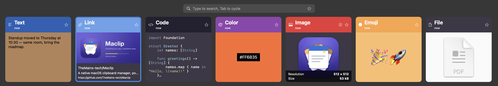
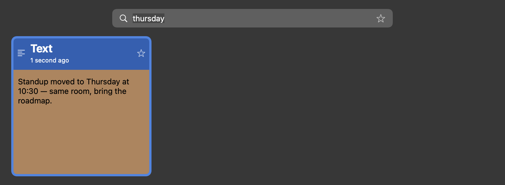
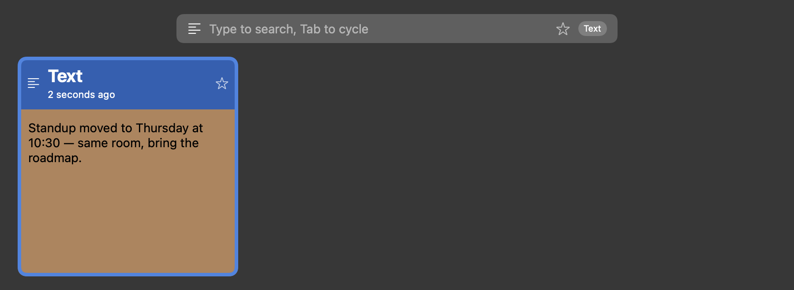
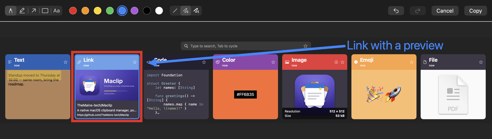

<p align="center">
  
</p>

<h1 align="center">Maclip</h1>

<p align="center">
  <b>Everything you copy, a keystroke away.</b><br>
  A native macOS clipboard manager: press <kbd>⌃⌘V</kbd>, find anything you've copied, and paste it back.
</p>

<p align="center">
  <a href="https://themains-tech.github.io/maclip-releases/Maclip-0.3.2.dmg"><b>⬇︎ Download Maclip 0.3.2 (DMG)</b></a><br>
  <sub>macOS 15 or later · signed and notarized by Apple · updates itself</sub>
</p>



Maclip keeps a **History** of everything you copy: text, links, code, colours, images, emoji and
files. It shows them as cards in a **Panel** along the edge of your screen. Search them, filter by
type, keep favourites, and paste any of them into the app you were using without touching the mouse.
Maclip also takes screenshots, lets you draw on them, and snaps windows to halves of the screen.

Maclip is a macOS port of [Pano](https://github.com/oae/gnome-shell-pano), the GNOME Shell clipboard
manager. The source is at [TheMains-tech/Maclip](https://github.com/TheMains-tech/Maclip) (GPL-2.0-or-later).

---

## Install

1. [Download the DMG](https://themains-tech.github.io/maclip-releases/Maclip-0.3.2.dmg) and open it.
2. Drag **Maclip** into **Applications**, then open it from there.
3. A welcome window asks for two permissions:
   - **Accessibility** lets Maclip paste the clip you choose straight into your app. It is also
     needed for window shortcuts. Without it, choosing a clip only copies it, and you press
     <kbd>⌘V</kbd> yourself.
   - **Paste from Other Apps** is needed only if macOS blocks clipboard access. Maclip can't
     record anything without it.

Maclip lives in the **menu bar** (it has no Dock icon) and starts automatically when you log in.
New versions install themselves, or choose **Check for Updates…** from the menu bar menu.

## Everyday use

1. Copy things as you normally do. Each copy becomes a card at the front of the Panel.
2. Press <kbd>⌃⌘V</kbd> to open the Panel.
3. Type to search, or use the arrow keys to walk along the cards.
4. Press <kbd>↩</kbd> (or click a card) to paste it into the app you were in.

When the Panel opens, the cursor is already in the search box, so you can start typing at once.
If the first key you press is <kbd>→</kbd>, Maclip starts walking along the cards instead.

### Search and filter

Typing searches every clip, ignoring case and accents:



Press <kbd>Tab</kbd> to show only one type of clip: Link, Text, Emoji, File, Image, Code or Color.
Press it again for the next type, or <kbd>⇧Tab</kbd> to go back. <kbd>⌫</kbd> in an empty search
box clears the filter.



### Keyboard reference

| Key | What it does |
| --- | --- |
| <kbd>⌃⌘V</kbd> | Open or close the Panel, from any app |
| <kbd>⌃⇧⌘V</kbd> | Turn Incognito on or off. Nothing is recorded while it's on |
| <kbd>←</kbd> <kbd>→</kbd> <kbd>↑</kbd> <kbd>↓</kbd> | Move between cards, and between the search box and the cards |
| <kbd>Home</kbd> <kbd>End</kbd> <kbd>Page Up</kbd> <kbd>Page Down</kbd> | Jump to the first or last card, or a screenful at a time |
| Type anything | Search |
| <kbd>Tab</kbd> / <kbd>⇧Tab</kbd> | Cycle the type filter |
| <kbd>↩</kbd> or click | Paste the card |
| <kbd>⇧↩</kbd> | Paste as plain text, without formatting |
| <kbd>⌘↩</kbd> or <kbd>⌘</kbd>-click | Paste a link and open it in your browser |
| <kbd>⌘1</kbd> … <kbd>⌘9</kbd> | Paste the card at that position |
| <kbd>⌘S</kbd> | Make the card a Favorite, or stop it being one |
| <kbd>⌥</kbd> (tap on its own) | Show only Favorites, or everything again |
| <kbd>⌘E</kbd> | Draw on an image card in the image editor |
| <kbd>⌘⌫</kbd> | Delete the card |
| <kbd>Esc</kbd> | Close the Panel |

The mouse wheel and trackpad scroll the cards too.

### Favorites

Star a card (or press <kbd>⌘S</kbd>) to keep it for good. Favorites are never removed when
History gets full, when you clear History, or when Session-only Mode wipes it. Tap <kbd>⌥</kbd>
on its own to see only your Favorites.

### Incognito

Copying a password or anything private? Turn on **Incognito** (<kbd>⌃⇧⌘V</kbd> or the menu bar
menu). The Panel turns a different colour and nothing is recorded until you turn it off.
Password managers that mark their copies as private are skipped automatically, and you can list
apps whose copies should always be ignored (Settings › General › Exclusion List).

## Screenshots and the image editor



Set a shortcut for each kind of screenshot in **Settings › General › Screenshots**:

- **Entire Screen**: the display under the pointer.
- **Selected Area**: drag a rectangle.
- **Window**: click a window.
- **Screenshot Toolbar**: the usual <kbd>⌘⇧5</kbd> toolbar.

None is set until you choose one. The first screenshot asks for **Screen Recording** permission
(System Settings › Privacy & Security › Screen & System Audio Recording).

Each screenshot opens in the image editor first. Draw on it with the **pen**, **highlighter**,
**arrow**, **rectangle** and **text** tools, in eight colours and three thicknesses. <kbd>⌘Z</kbd>
undoes and <kbd>⇧⌘Z</kbd> redoes. **Copy** (<kbd>⌘↩</kbd>) puts the result on the clipboard and in
History. **Cancel** (<kbd>Esc</kbd>) throws it away.

Prefer plain screenshots? Turn off **Edit screenshots after taking them**. The separate
"…then Edit" shortcuts still open the editor when you want it. To draw on an image that's already
in History, press <kbd>⌘E</kbd> on its card or click its pencil button.

## Window shortcuts

| Key | What it does |
| --- | --- |
| <kbd>⌃⌥⌘←</kbd> | Put the front window on the left half of its screen |
| <kbd>⌃⌥⌘→</kbd> | Put it on the right half |
| <kbd>⌃⌥⌘↑</kbd> | Make it fill the screen. Press again to put it back |
| <kbd>⌃⌥⌘↓</kbd> | Minimize it |

Change them in **Settings › General › Window Shortcuts**. They need the Accessibility permission.

## Settings

Open **Settings…** from the menu bar menu.

- **General**
  - **History Length**: how many clips to keep (1000 by default; Favorites don't count).
  - **Panel edge**: which edge of the screen the Panel appears on.
  - **Database location**: where History is stored.
  - **Shortcuts**: change the Panel and Incognito shortcuts.
  - **Screenshots** and **Window Shortcuts**: as above.
  - **Behaviour**: paste on select, link previews, keep search text, and open links in the browser.
  - **Feedback**: notifications, sounds and the menu bar icon.
  - **Exclusion List**: apps whose copies are ignored.
- **Customization**: card size, and the colours and fonts for every type of clip.
- **Danger Zone**
  - **Session-only Mode**: wipes History, except Favorites, whenever Maclip quits.
  - **Clear History**: removes every clip except Favorites.

History is stored on your Mac in `~/Library/Application Support/Maclip` unless you move it.
Maclip doesn't send your clips anywhere. Link previews fetch the linked page to show its title
and image; turn them off in Settings if you prefer.

## Automation

Maclip responds to `maclip://` links, so you can drive it from Terminal, a launcher, or a script:

```sh
open maclip://toggle         # open or close the Panel (also: show, hide)
open maclip://stop           # stop recording copies until maclip://start
open maclip://clear-history  # clear History, keeping Favorites (no confirmation)
```

The same actions appear in the **Shortcuts** app and in Spotlight, along with **Toggle Maclip Incognito**.

## Questions

**Choosing a card copies it but doesn't paste it.**
Maclip needs Accessibility permission to paste. Turn it on in System Settings › Privacy & Security
› Accessibility. If Maclip is already listed and on, switch it off and on again.

**Maclip isn't recording what I copy.**
Check that Incognito is off. Check that the app you're copying from isn't in the Exclusion List.
If macOS asked about pasting from other apps and you chose "Don't Allow", turn it back on in
System Settings › Privacy & Security › Paste from Other Apps.

**I lost my older clips.**
History keeps the most recent clips up to the History Length (Settings › General), and Favorites
are always kept. Raise the length to keep more.

**How do I uninstall it?**
Quit Maclip from its menu bar menu, then drag it from Applications to the Bin. To remove your
History as well, delete `~/Library/Application Support/Maclip`.

---

<sub>This repository hosts Maclip's downloads and its update feed (`appcast.xml`). Older versions'
update files are kept here so installed copies can update with a small download.</sub>
